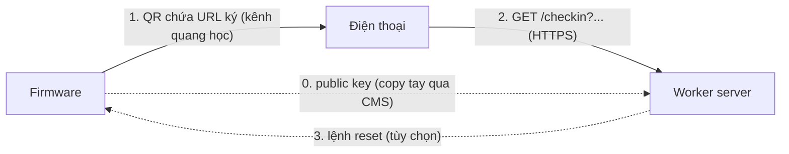

# Contract giữa firmware và worker server

File này là hợp đồng chung. Hai bên phải làm đúng theo đây thì ghép được với nhau.
Xem thêm: [overview.md](./overview.md), [firmware-tasks.md](./firmware-tasks.md), [server-tasks.md](./server-tasks.md).

Trạng thái: bản nháp. Mục đánh dấu **[CẦN QUYẾT]** chưa chốt.

## 0. Nguyên tắc

- Firmware và server không gọi API trực tiếp trong luồng check-in. Cầu nối là **mã QR chứa URL đã ký**, người chơi quét rồi mở URL trên điện thoại.
- Firmware giữ **private key**. Server chỉ giữ **public key**.
- Firmware chỉ cần giờ chuẩn (NTP). Server dùng giờ của chính nó để kiểm tra hạn.
- Các kênh phụ (đăng ký public key, lệnh reset từ xa) là tùy chọn, ghi ở mục 5 và 6.



## 1. Khóa và chữ ký

| Mục | Giá trị |
|---|---|
| Thuật toán | **[CẦN QUYẾT]** Ed25519 (ưu tiên) hoặc ECDSA P-256. Phải kiểm tra thư viện trên ESP và WebCrypto trên Workers đều hỗ trợ |
| Private key | Nằm trên firmware, không bao giờ rời thiết bị |
| Public key | Đăng ký lên server, định dạng base64url của raw key |
| Chuỗi được ký (message) | `v1.<did>.<t>` (ASCII, không khoảng trắng) |
| Chữ ký | Base64url, không padding |

Trong đó:
- `v1`: phiên bản giao thức, để nâng cấp sau này.
- `did`: id thiết bị (ví dụ `door-1`), để server chọn đúng public key. Nếu dùng chung một key cho mọi cửa vẫn giữ trường này, server có thể bỏ qua.
- `t`: unix time (giây), đã làm tròn xuống theo chu kỳ N: `t = floor(now / N) * N`.

## 2. Định dạng QR

Nội dung QR là URL:

```
https://<host>/checkin?v=1&did=<did>&t=<unix>&sig=<base64url>
```

| Tham số | Kiểu | Bắt buộc | Mô tả |
|---|---|---|---|
| `v` | số | có | Phiên bản giao thức, hiện là `1` |
| `did` | chuỗi `[a-z0-9-]{1,32}` | có | Id thiết bị |
| `t` | số nguyên | có | Unix time (giây) lúc sinh mã |
| `sig` | chuỗi base64url | có | Chữ ký của `v1.<did>.<t>` |

Ràng buộc:
- Độ dài URL nên dưới khoảng 200 ký tự để QR thưa, dễ quét. Chữ ký Ed25519 base64url khoảng 86 ký tự.
- Host cố định, cấu hình sẵn trong firmware.
- Firmware đổi `t` mỗi N giây. Mặc định N = 30, cấu hình trên server làm tham chiếu (xem mục 4).

## 3. API check-in (người chơi gọi, server xử lý)

### `GET /checkin`

Yêu cầu người chơi đã đăng nhập (phiên hiện có của app). Chưa đăng nhập thì chuyển sang đăng nhập rồi quay lại đúng URL này.

Xử lý theo thứ tự:
1. Kiểm tra đủ và đúng kiểu `v`, `did`, `t`, `sig`. Thiếu hoặc sai thì `400`.
2. `v` phải là phiên bản được hỗ trợ.
3. Tìm public key theo `did`. Không có thì `404`.
4. Verify `sig` với message `v1.<did>.<t>`. Sai thì `401`.
5. Tính `age = now - t`.
   - `age > TTL` thì `410`.
   - `age < -SKEW` (mã từ tương lai quá xa) thì `400`. Mặc định `SKEW = 5` giây.
6. Chống phát lại: ghi nhận cặp (user, `did`, `t`). Cùng user dùng lại cùng mã thì coi như đã check-in rồi, trả thành công nhưng không tạo lượt mới.
7. Ghi check-in cho user, có thời hạn hiệu lực `CHECKIN_VALID_SECONDS`.
8. Trả `302` về trang xin tem.

### Phản hồi

| Mã | Khi nào | Body (JSON khi gọi bằng `Accept: application/json`) |
|---|---|---|
| 302 | Thành công | Header `Location: /stamp` (đường dẫn trang xin tem, **[CẦN QUYẾT]** tên route thật) |
| 400 | Thiếu hoặc sai tham số, hoặc `t` ở tương lai quá xa | `{"error":"bad_request"}` |
| 401 | Chữ ký không hợp lệ | `{"error":"invalid_signature"}` |
| 404 | `did` không tồn tại | `{"error":"unknown_device"}` |
| 410 | Mã hết hạn | `{"error":"expired"}` |
| 429 | Gọi quá nhiều | `{"error":"rate_limited"}` |

Khi gọi từ trình duyệt (không phải JSON), server hiển thị trang lỗi thân thiện với cùng mã trạng thái, kèm nút "Quét lại".

### `GET /api/checkin/status`

Trang xin tem hỏi người chơi đã check-in còn hiệu lực chưa.

Phản hồi `200`:

```json
{
  "checkedIn": true,
  "expiresAt": 1767225600,
  "deviceId": "door-1"
}
```

Chưa check-in hoặc đã hết hạn: `{"checkedIn": false}`.

### Quy tắc dùng check-in trong luồng xin tem

- Các API nhận dữ kiện và nhận ảnh vật phẩm phải kiểm tra check-in còn hiệu lực. Không có thì trả `403 {"error":"checkin_required"}`.
- Trang web, khi nhận `checkin_required`, hiện nút "Check in" để người chơi quét QR.

## 4. Cấu hình dùng chung

| Tham số | Mặc định | Ai giữ | Ghi chú |
|---|---|---|---|
| `N` chu kỳ đổi mã | 30 s | Firmware | Server không ép, nhưng `TTL` nên lớn hơn `N` |
| `TTL` hạn của mã | 60 s | Server | Cấu hình được: 10/20/30/60 s. Phải >= `N` + độ trễ mạng. 5 s quá rủi ro |
| `SKEW` lệch giờ cho phép | 5 s | Server | Cho mã hơi đi trước giờ server |
| `CHECKIN_VALID_SECONDS` | **[CẦN QUYẾT]** | Server | Một lượt check-in có hiệu lực bao lâu |

Quy tắc chọn: `TTL >= N + 10` giây để người chơi quét xong vẫn kịp gửi.

## 5. Đăng ký public key (kênh quản trị)

Không phải API firmware gọi. Quy trình thủ công:
1. Setup thiết bị, thiết bị hiển thị public key (base64url) trên trang settings.
2. Admin copy và dán vào CMS của server.

### `PUT /api/admin/checkin/devices/{did}` (chỉ admin)

Yêu cầu:

```json
{
  "publicKey": "<base64url>",
  "alg": "ed25519",
  "enabled": true
}
```

Phản hồi `200`: `{"did":"door-1","alg":"ed25519","enabled":true}`.

Các endpoint kèm theo (cùng quyền admin):
- `GET /api/admin/checkin/devices`: danh sách thiết bị.
- `DELETE /api/admin/checkin/devices/{did}`: gỡ thiết bị.
- `GET` và `PUT /api/admin/checkin/config`: đọc và sửa `TTL`, `SKEW`, `CHECKIN_VALID_SECONDS`.

## 6. Lệnh reset từ xa (tùy chọn)

Chỉ làm nếu chọn phương án này ở firmware Step 8. Thiết bị chủ động hỏi server (polling), vì thiết bị ở sau NAT và không nhận kết nối vào.

### `POST /api/device/poll`

Thiết bị gọi định kỳ (ví dụ 60 giây). Mọi yêu cầu phải ký để server biết đúng thiết bị.

Yêu cầu:

```json
{
  "v": 1,
  "did": "door-1",
  "t": 1767225600,
  "sig": "<base64url>"
}
```

Message được ký: `v1.poll.<did>.<t>`.

Phản hồi `200`:

```json
{ "command": null }
```

hoặc

```json
{ "command": "wipe_wifi", "cmdId": "c_123", "t": 1767225600, "sig": "<base64url>" }
```

Quy tắc xác thực lệnh từ server tới thiết bị: **[CẦN QUYẾT]** cách thiết bị tin lệnh của server. Gợi ý: server giữ một khóa ký riêng, thiết bị giữ public key của server. Nếu không, chỉ cần dựa vào HTTPS tới đúng host cố định và chữ ký của thiết bị trong yêu cầu poll.

### `POST /api/device/ack`

Thiết bị báo đã thực hiện lệnh: `{"v":1,"did":"door-1","cmdId":"c_123","t":...,"sig":"..."}`. Phản hồi `204`.

### Phát lệnh (admin)

`POST /api/admin/checkin/devices/{did}/commands` với `{"command":"wipe_wifi"}`. Lệnh chờ cho tới khi thiết bị poll và ack.

## 7. Yêu cầu về thời gian

- Firmware: đồng bộ NTP mỗi lần boot và định kỳ. Chưa có giờ chuẩn thì không hiện QR.
- Server: dùng giờ hệ thống Workers (`Date.now()`).
- Độ lệch đồng hồ firmware lớn hơn `TTL` thì mọi mã đều bị từ chối. Server nên ghi log tỉ lệ `410` theo `did` để phát hiện thiết bị lệch giờ.

## 8. Bảo mật

- Toàn bộ qua HTTPS. Không đưa thông tin cá nhân vào query string (QR chỉ chứa `v`, `did`, `t`, `sig`).
- Không log `sig` đầy đủ nếu không cần.
- So sánh chữ ký bằng hàm verify của thư viện, không so sánh chuỗi.
- Rate limit `/checkin` theo user và theo IP.
- Lộ public key không gây gian lận. Lộ private key thì phải thay khóa: đổi key trên thiết bị rồi `PUT` lại public key mới.

## 9. Test vector

Cần có cặp (private key, public key, `did`, `t`, `sig`) mẫu dùng chung để firmware và server cùng kiểm tra. **[CẦN LÀM]** sinh sau khi chốt thuật toán, lưu cạnh file này (ví dụ `contract-vectors.json`).

Các trường hợp tối thiểu:

| # | Mô tả | Kết quả mong đợi |
|---|---|---|
| 1 | Mã hợp lệ, `age` = 5 s | 302 |
| 2 | `sig` bị sửa 1 ký tự | 401 |
| 3 | `age` > TTL | 410 |
| 4 | `t` trong tương lai > SKEW | 400 |
| 5 | `did` không tồn tại | 404 |
| 6 | Thiếu `sig` | 400 |
| 7 | Dùng lại cùng mã, cùng user | 302, không tạo lượt mới |

## 10. Danh sách việc còn mở

- [ ] Chốt thuật toán ký (Ed25519 hay ECDSA P-256)
- [ ] Chốt route trang xin tem thật thay cho `/stamp`
- [ ] Chốt `CHECKIN_VALID_SECONDS`
- [ ] Chốt có làm reset từ xa không, và cách xác thực lệnh
- [ ] Sinh test vector và lưu lại
- [ ] Đối chiếu với route và middleware xác thực hiện có trong `apps/worker`
