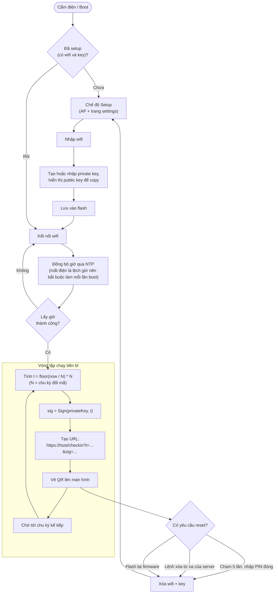

# Firmware (thiết bị check-in ở cửa)

Thiết bị ESP có màn hình, đặt ở cửa, hiển thị QR đổi mã theo chu kỳ. Firmware chỉ cần một đồng hồ chuẩn và khóa bí mật để ký, nên đơn giản hơn nhiều firmware khác.

Xem tổng quan tại [overview.md](./overview.md), phía server tại [server.md](./server.md).

## Trách nhiệm

- Giữ private key và wifi trong flash, không mất khi rút điện.
- Đồng bộ giờ chuẩn qua NTP mỗi lần boot.
- Mỗi N giây: tính `t`, ký `sig = Sign(privateKey, t)`, vẽ QR chứa URL `https://<host>/checkin?t=…&sig=…`.
- Cho phép setup lần đầu qua trang settings: chỉnh wifi và copy public key.

## Vòng đời

## Setup lần đầu

- Chỉ setup một lần. Sau đó cắm điện là chạy, rút điện rồi cắm lại thì tự đồng bộ giờ và chạy tiếp.
- Trang settings: chỉnh wifi, và copy public key để dán vào web console của server. Không cho set public key ngược vào thiết bị.
- Public key lộ ra ngoài không sao, nó chỉ dùng để xác thực chữ ký.
- Hướng đang nghiêng tới: private key được cấu hình ở web console rồi đưa vào thiết bị, hoặc thiết bị tự sinh cặp khóa rồi hiển thị public key. Chưa chốt hẳn, cần quyết khi làm.

## Rủi ro

- Wifi của thiết bị bị người khác vào nghịch: sau khi setup xong phải tắt AP/trang settings.
- Cần có cách reset khi đổi wifi hoặc đổi khóa (chưa chốt):
  1. Flash lại firmware (chắc chắn nhất).
  2. Chạm màn hình 5 lần, hiện bàn phím số, nhập đúng PIN thì xóa cấu hình. Chỉ dùng được nếu màn hình có cảm ứng, hiện chưa chắc có.
  3. Nút cứng đấu ra ngoài vỏ (phải in 3D vỏ khác).
  4. Lệnh xóa wifi từ xa: thiết bị giữ một kết nối tới server, nhận lệnh thì tự xóa phần wifi.
- Mất điện thì mất giờ: phải có wifi để đồng bộ lại.
- Các thiết bị dùng chung một private key nếu có nhiều cửa.
