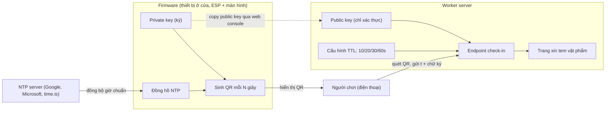
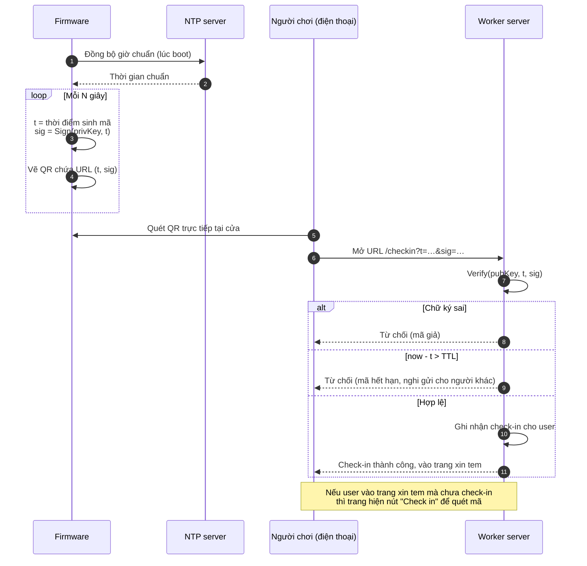

# Check-in bằng QR đổi mã: tổng quan luồng

Mục đích: người chơi phải có mặt tại cửa mới xin được tem (chống ngồi nhà chụp ảnh trên mạng).
Thiết bị ở cửa hiển thị QR đổi mã liên tục, server xác thực chữ ký và thời gian.

- Chi tiết firmware: [firmware.md](./firmware.md)
- Chi tiết worker server: [server.md](./server.md)

## Tổng quan hai đối tượng

## Sequence: một lần check-in và xin tem

## Quyết định thiết kế đã chốt

- Chống ngồi nhà: bắt buộc check-in tại cửa. Không chặn tuyệt đối (một người ở cửa vẫn có thể gửi mã cho người khác trong TTL) nhưng giảm rất nhiều.
- Private key chỉ nằm ở firmware. Server chỉ giữ public key. Lộ public key không gây gian lận.
- TTL và chu kỳ đổi mã cấu hình được (10/20/30/60 giây). 5 giây thì rủi ro cao vì độ trễ mạng.
- Firmware cần wifi mỗi lần boot để đồng bộ NTP (mất điện là lệch giờ).
- Nhiều cửa dùng chung một private key. Dự kiến chỉ 1 đến 2 thiết bị.
- Chưa chốt: cách reset thiết bị (xem [firmware.md](./firmware.md)).
